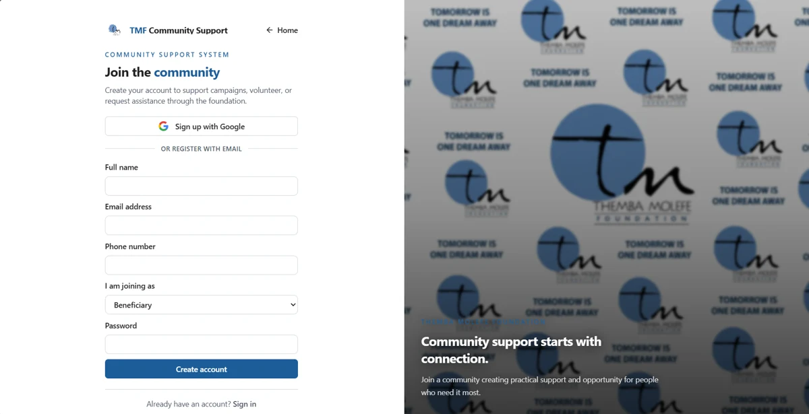
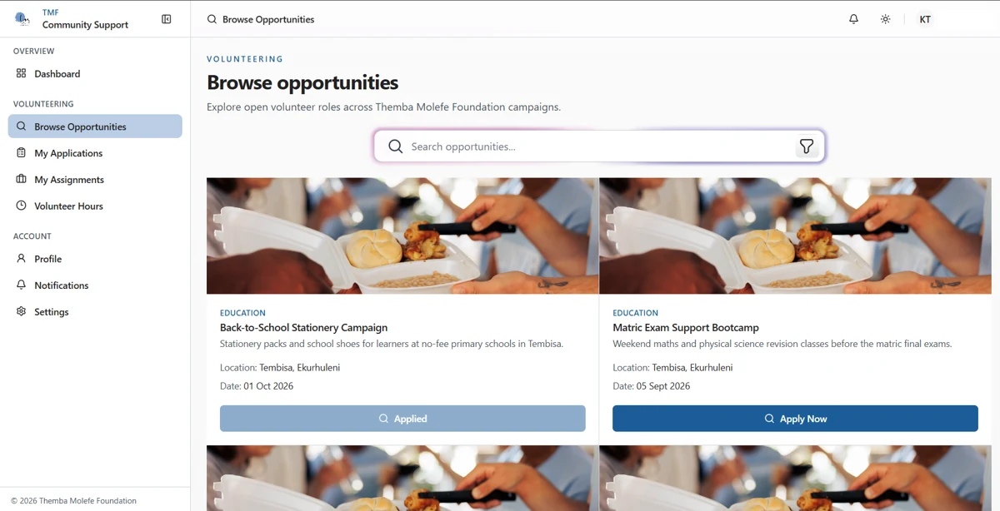
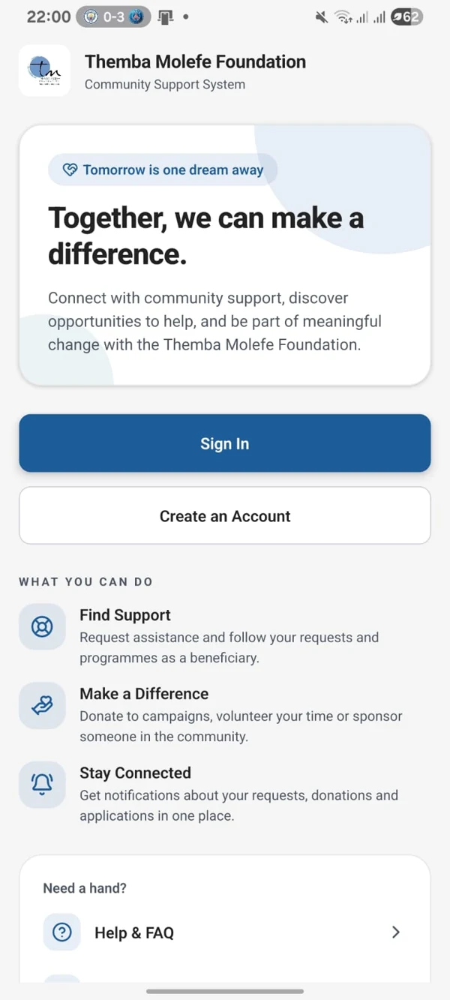
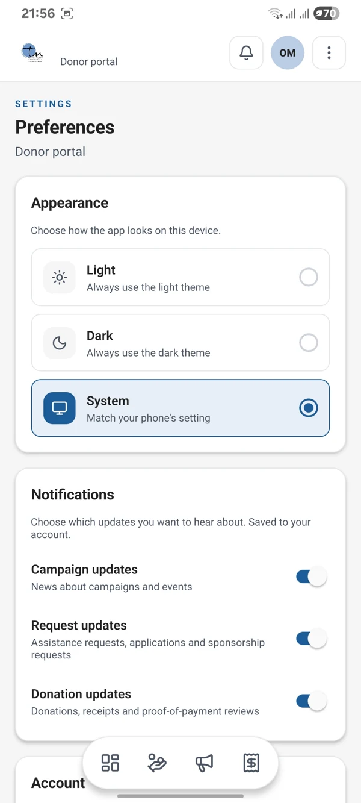
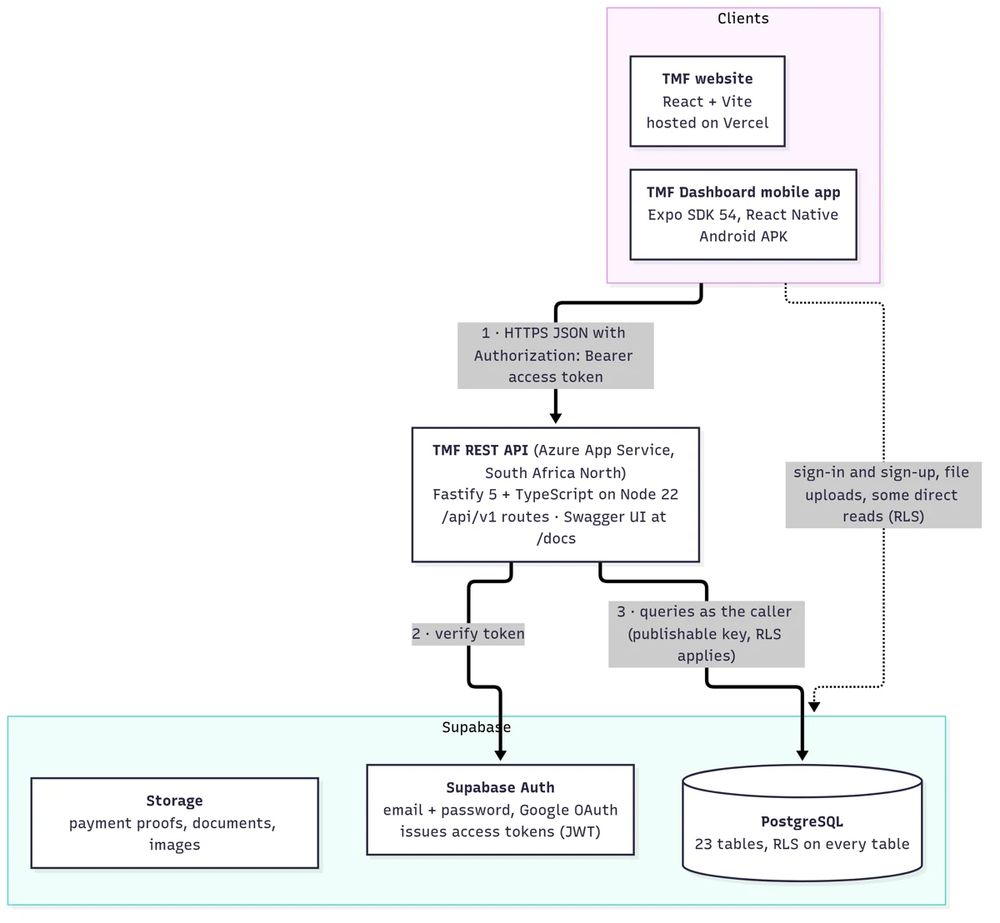
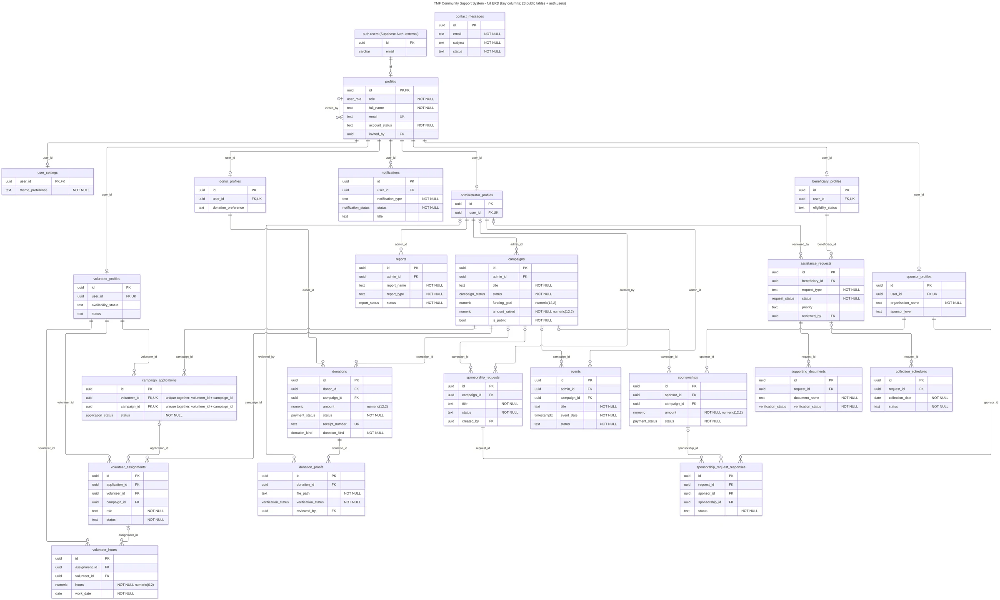
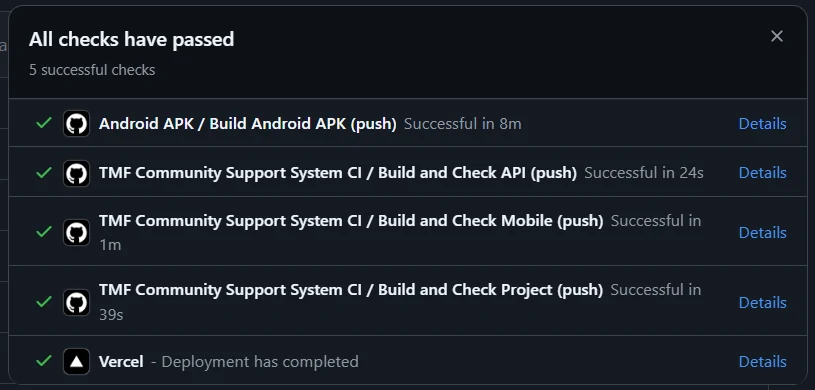

<p align="center"></p>

# Themba Molefe Foundation Community Support System

**Tomorrow is one dream away.**

The TMF Community Support System brings the Themba Molefe Foundation's public website and community-support administration into one project. It helps the foundation organise campaigns, donations, assistance requests, volunteering and sponsorships instead of keeping separate records for each activity. The website is the public entry point; TMF Dashboard provides mobile access to role-based work.

Developed by **ROS** for **XISD6329**, the project combines a React website, an Expo/React Native mobile app, a Fastify REST API and a shared Supabase backend.

- [Website](https://tmf-community-support-system.vercel.app)
- [Releases and Android downloads](https://github.com/OdirileMasemola/TMF-community-support-system/releases) — latest project release: **v1.0.5**
- [GitHub Actions](https://github.com/OdirileMasemola/TMF-community-support-system/actions)

## Website and mobile preview



The implemented website registration page, including Google sign-up and email registration.



The volunteer portal separates browsing opportunities, applications, assignments and recorded hours.

<p align="center"> </p>

These are real screenshots extracted from the Task 3 report, not new captures of the latest release. See [image provenance and limitations](docs/images/SOURCES.md).

## Purpose and features

Public visitors can learn about TMF, explore campaigns, get involved, donate and contact the foundation. Signed-in users enter one of **five role-based portals**:

| Role | Main features |
| --- | --- |
| Administrator | Oversee users, campaigns, events and reports; review donation proofs, assistance requests and volunteer applications; manage sponsorship requests and collection schedules. |
| Donor | Browse campaigns, record donations, submit payment proofs, follow donation history and manage account settings. |
| Volunteer | Browse opportunities, apply, follow assignments, record hours and manage profile details. |
| Beneficiary | Submit assistance requests and supporting documents, follow decisions and collection schedules, and view notifications. |
| Sponsor | Record sponsorship commitments, explore open sponsorship requests, register interest and review sponsorship history. |

Shared features include email/password sign-in, Google authentication, role-based navigation, profile/settings screens, theme preferences and in-app notifications. Google sign-up defaults to beneficiary; users cannot promote their own role. Administrator access must be managed by an authorised administrator.

### Changes addressed after lecturer feedback

- **Password recovery on web and mobile:** request a Supabase recovery email, open the reset link and set a new password. The web uses `/forgot-password` and `/reset-password`; the installed app uses its `tmfdashboard` deep-link scheme. Recovery redirects and email delivery must be configured in Supabase.
- **Notification preferences:** campaign, request and donation switches are saved to `user_settings`. [The enforcement migration](supabase/migrations/20261008150000_enforce_notification_preferences.sql) checks preferences before creating in-app notifications. Donation alerts use the donation switch; assistance, application and contact alerts use the request switch; campaign alerts use the campaign switch. Missing settings default to enabled. These are not push or email subscriptions.
- **Account self-deletion:** the mobile Settings screen calls `delete_own_account()`. [The deletion migration](supabase/migrations/20261108120000_account_self_deletion.sql) deletes the calling account and cascaded profile records while retaining donation rows without the donor link. Administrators cannot self-delete. This requires the migration to be deployed; live deletion was not verified in this documentation update.
- **Privacy information:** public [privacy policy](web/src/pages/public/PrivacyPolicyPage.tsx) and [account-deletion page](web/src/pages/public/AccountDeletionPage.tsx), served at `/privacy-policy` and `/account-deletion`, are linked from mobile Settings.
- **Quality checks:** web lint is required in CI alongside web, API and mobile tests and builds.

## Design considerations

- **Different audiences:** public information stays on the website; signed-in mobile workflows focus on practical community-support tasks.
- **Role separation:** each portal has relevant navigation. API role checks and PostgreSQL Row Level Security (RLS), not just hidden buttons, protect data access.
- **Consistency:** shared TMF branding, recognisable cards, status labels and similar workflows connect desktop and phone experiences.
- **Usability:** responsive web layouts, mobile bottom navigation, clear validation, loading/empty/error states and theme preferences support day-to-day use.
- **Privacy and accountability:** user-scoped data access, controlled proof/document uploads, notification choices and explicit deletion information reduce unnecessary exposure. Donation records are retained separately from deleted donor accounts.
- **Maintainability:** TypeScript, separate client/service modules, SQL migrations and automated tests make changes easier to check and explain.

## Technology and architecture

| Component | Main technologies | Documentation |
| --- | --- | --- |
| Website | React, TypeScript, Vite, React Router, Tailwind CSS, TanStack Query, Vitest, ESLint | [Web README](web/README.md) |
| Mobile | Expo SDK 57, React Native 0.86, React 19, Expo Router, TypeScript, Jest | [Mobile README](mobile/README.md) |
| REST API | Node.js 22, Fastify 5, TypeScript, JSON Schema, Swagger/OpenAPI, Vitest | [API README](api/README.md) |
| Backend | Supabase Auth, PostgreSQL, RLS, Storage, SQL migrations | [Migrations](supabase/migrations/) and [seed documentation](supabase/seed/README.md) |



The report's architecture diagram labels an older **Expo SDK 54** baseline; the current mobile package uses **SDK 57**. Clients sign in through Supabase Auth and send bearer tokens to the REST API for operational requests. The API validates the token and queries as the caller, so RLS applies. Authentication, file uploads and some reads/RPC calls also use Supabase directly. Client defaults point to the Azure API; the web is configured for Vercel. Deployment availability was not re-tested here.



The ERD records the report's database baseline: profiles, role profiles and community-support records. It predates account deletion: the newer migration makes `donations.donor_id` nullable with `ON DELETE SET NULL`. Use the SQL migrations as the current schema source; open the image separately to read the larger diagram.

## Repository structure

```text
web/                 Public website and browser portals
mobile/              Expo dashboard app
api/                 Fastify REST API and route tests
supabase/migrations/ Database schema and security changes
supabase/seed/       Controlled test accounts and sample data
docs/images/         Optimised report screenshots and provenance
.github/workflows/   CI and Android build definitions
```

## Local setup

Use **Node.js 22.13 or newer on the 22.x line**, npm and a configured Supabase project. The API requires Node >=22.12; mobile needs >=22.13. Each component has its own `package.json` and lockfile; there is no root install/run script.

1. Clone the repository and enter its folder.
2. Configure the values below in your local development environment. Never commit secrets or use a Supabase service-role key in either client.
3. Install each component with `npm ci`, then start it in a separate terminal:

```bash
# Website
cd web
npm ci
npm run dev

# API, from the repository root in another terminal
cd api
npm ci
npm run dev

# Mobile, from the repository root in another terminal
cd mobile
npm ci
npm start
```

| Component | Required configuration | Optional configuration |
| --- | --- | --- |
| Web | `VITE_SUPABASE_URL`, `VITE_SUPABASE_PUBLISHABLE_KEY` | `VITE_API_URL` (defaults to `https://tmf-task2-api.azurewebsites.net`) |
| Mobile | `EXPO_PUBLIC_SUPABASE_URL`, `EXPO_PUBLIC_SUPABASE_PUBLISHABLE_KEY` | `EXPO_PUBLIC_API_URL` (same API default), `EXPO_PUBLIC_WEB_URL` (web links) |
| API | `SUPABASE_URL`, `SUPABASE_PUBLISHABLE_KEY` | `PORT` (3000), `CORS_ORIGINS`, `LOG_LEVEL`, `RATE_LIMIT_MAX`, `API_VERSION` |

To use your local API, set the client's API URL to its reachable address. A physical Android phone cannot reach the development computer through `localhost`; use that computer's LAN address. Configure CORS for the web origin. Supabase Google OAuth, recovery email settings and redirect allowlists are external prerequisites, not created by `npm ci`.

Database changes need an authorised deployment. **Two migration files currently share `20261008150000`**; reconcile the migration history before automated replay rather than assuming a fresh migration run will succeed. Do not run seed or cleanup scripts on production without approval.

### Checks before committing

```bash
# In web/
npm run lint
npm test
npm run build

# In api/
npm run typecheck
npm test
npm run build

# In mobile/
npm run typecheck
npm test -- --ci
npx expo export --platform android
```

## GitHub and GitHub Actions

GitHub stores source code, SQL migrations, documentation, commit history and tagged releases. Pushes and pull requests targeting `main` run [the CI workflow](.github/workflows/ci.yml). Its three parallel jobs are:

| Job | Checks |
| --- | --- |
| Web — Build and Check Project | Node 20, `npm ci`, `npm run lint` (`--max-warnings 0`), TypeScript/Vite build, `npm run test --if-present` (the test script exists and runs Vitest). |
| API — Build and Check API | Node 22, `npm ci`, TypeScript type-check, Vitest tests and compiled build. Tests use test configuration/mocks. |
| Mobile — Build and Check Mobile | Node 22, `npm ci`, TypeScript type-check, Jest in CI mode and Android JavaScript export. This job is not a signed native build. |



This historical screenshot records successful checks at capture time; it is not proof that every later commit passed. The current YAML files define the checks described above.

### Android APK and AAB workflow

[Android APK](.github/workflows/android-apk.yml) runs manually or on pushes to `main` that change `mobile/**` or the workflow itself; it does not run on pull requests. It uses Node 22, JDK 17, Expo prebuild and Gradle to:

1. Require `EXPO_PUBLIC_SUPABASE_URL` and `EXPO_PUBLIC_SUPABASE_PUBLISHABLE_KEY` repository secrets.
2. Prepare upload-key signing from **`ANDROID_UPLOAD_KEYSTORE_BASE64`**, **`ANDROID_KEYSTORE_PASSWORD`**, **`ANDROID_KEY_ALIAS`** and **`ANDROID_KEY_PASSWORD`**. The keystore is decoded into runner temporary storage and passed through Gradle's `android.injected.signing.*` properties; it is not committed.
3. Run `assembleRelease` for an **arm64-v8a APK**, then `bundleRelease` for an **AAB** without that architecture restriction.
4. Retain artifacts for 14 days as `tmf-mobile-apk-upload` and `tmf-mobile-aab-upload`, or the corresponding `-debug` names.

If the keystore secret is absent, the workflow falls back to the debug key. **Debug-signed artifacts cannot be submitted to Google Play.** All four signing secrets must be valid for an upload-key build. Workflow configuration alone does not verify that those secrets exist or that any particular release asset uses the upload key. The workflow uploads Actions artifacts; it does not automatically create a GitHub Release.

## Releases and Google Play preparation

Download **v1.0.5** from [GitHub Releases](https://github.com/OdirileMasemola/TMF-community-support-system/releases). Use the APK for direct Android installation/testing and the AAB for a future Play upload only after verifying its signature. Git tags/releases and npm package versions are separate: `mobile/app.json` declares `1.0.5`, while `mobile/package.json` still declares `1.0.0`.

**Status: prepared for a Google Play submission, not published.** The project was not published because developer registration requires a fee. No payment, Play upload, listing or approval is claimed.

Repository preparation includes Android package `org.tmf.dashboard`, compile/target **API 36**, APK/AAB automation, optional upload-key signing, privacy-policy and account-deletion pages, and an in-app delete action. The Android configuration blocks microphone recording, legacy external-storage read/write, broad image/video/audio media access and system-alert-window permissions. The system photo picker is used without broad storage permission requests.

Before claiming full store readiness, verify the upload-key signature and release/versionCode progression, deploy and test the deletion migration, test recovery and Google sign-in on the final build, and complete the Play Console's current listing, data-safety and policy requirements. The report's fee screen is evidence of the registration cost, not proof of publication or policy acceptance.

To check all README image and relative file links locally, run `python3 scripts/check-readme-links.py` from the repository root.

## Team ROS

Names and student numbers are taken from the Task 3 report cover page.

| Team member | Student number |
| --- | --- |
| Ripfumelo Mabasa | ST10168130 |
| Sisipho Njili | ST10450294 |
| Lerato Mokoena | ST10104238 |
| Odirile Masemola | ST10441421 |

## Component documentation

- [Website setup and workflows](web/README.md)
- [Mobile setup, recovery and Android builds](mobile/README.md)
- [REST API endpoints and configuration](api/README.md)
- [Database seed data and safety](supabase/seed/README.md)
- [Website image conventions](web/src/assets/images/README.md)
