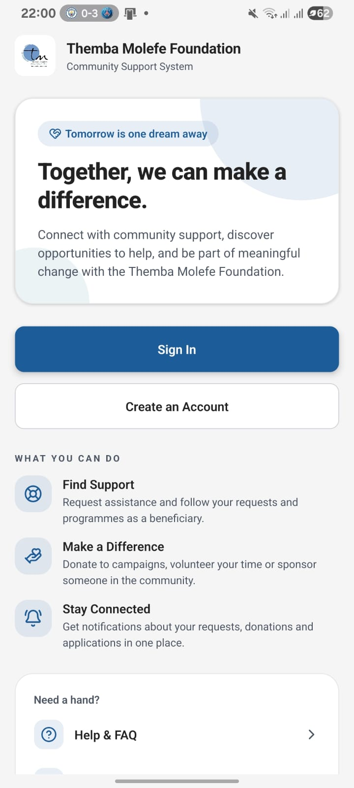
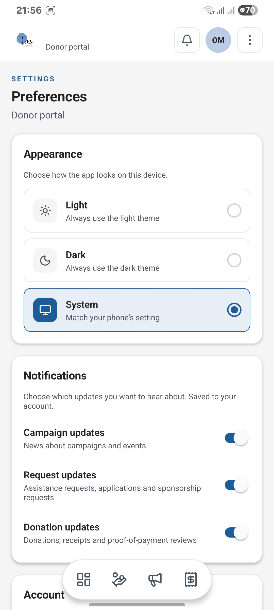

<p align="center"></p>

# TMF Dashboard Mobile App

TMF Dashboard is the Android-focused mobile companion to the Themba Molefe Foundation Community Support System. It lets dashboard users carry out community-support tasks away from a desktop. The public website provides the broader foundation information and registration journey; the app links users to that website when needed.

[Project overview and team](../README.md) | [Website](../web/README.md) | [REST API](../api/README.md)

<p align="center"> </p>
<p align="center"><em>TMF Dashboard welcome screen and notification preferences.</em></p>

## Purpose and five role portals

| Role | Mobile features |
| --- | --- |
| Administrator | Overview, campaigns, users/review queues, operational records, notifications and settings. |
| Donor | Giving overview, campaigns, donations, payment proofs, history and profile/settings. |
| Volunteer | Opportunities, applications, assignments, recorded hours and profile/settings. |
| Beneficiary | Assistance overview, new/existing requests, supporting documents, collection information and notifications. |
| Sponsor | Commitments, campaigns, sponsorships, open requests, responses and profile/settings. |

Sign-in uses the same Supabase account as the website. Google sign-up creates a **beneficiary** account by default; an authorised administrator must change a role when needed. Users cannot choose administrator access or edit their own stored role.

## Design and stack

- **Expo SDK 57**, React Native **0.86**, React **19**, TypeScript and Expo Router.
- Supabase Auth for sessions, Google authentication and recovery; bearer-token REST API calls for operational data, plus direct Supabase storage and selected database/RPC calls.
- TanStack Query for server state and Jest/jest-expo for tests.
- Phone-sized cards, role-specific bottom navigation, recognisable TMF branding, light/dark/system themes and clear validation/loading/error states.
- Privacy choices belong in Settings; authorisation is also checked by API roles and database RLS.

See the [shared architecture](../README.md#technology-and-architecture).

## Password recovery

1. Open sign-in and choose **Forgot password**.
2. Enter the account email and request the recovery link.
3. Open the link on the device, set a new password and return to sign-in as prompted.

[AuthProvider](src/auth/AuthProvider.tsx) sends the reset email with an Expo-generated URL for `reset-password`. For an installed build, configure Supabase to allow **`tmfdashboard://reset-password`** as well as the application's OAuth callback (`tmfdashboard://auth/callback`). Development URLs differ under Expo Go; use the actual redirect generated for that environment. Supabase email delivery and redirect settings are prerequisites, and end-to-end delivery must be tested against the configured service.

## Notification preferences and deletion

Settings save campaign, request and donation choices to `user_settings`. [Migration 20261008150000_enforce_notification_preferences.sql](../supabase/migrations/20261008150000_enforce_notification_preferences.sql) applies them before new in-app notifications are inserted. Donation updates follow the donation switch; application, assistance and contact updates follow the request switch; campaign updates follow the campaign switch. Missing settings default to enabled. There is no push/email notification channel in this implementation.

Under **Settings → Privacy**, users can open the privacy policy, read account-deletion information and confirm **Delete account**. [The account service](src/services/account.ts) calls `delete_own_account()` and signs out locally. [The database migration](../supabase/migrations/20261108120000_account_self_deletion.sql) must be deployed first. It preserves donation records with a null donor reference and blocks administrator self-deletion. A successful live deletion was not verified in this documentation update.

The website's `/privacy-policy` and `/account-deletion` pages are used by [mobile links](src/lib/links.ts). `EXPO_PUBLIC_WEB_URL` overrides the default web origin if the website moves.

## Local setup

Use Node **22.13+ on the 22.x line** and npm. From the repository root:

```bash
cd mobile
npm ci
npm start
```

Configure `EXPO_PUBLIC_SUPABASE_URL` and `EXPO_PUBLIC_SUPABASE_PUBLISHABLE_KEY` locally; `EXPO_PUBLIC_SUPABASE_ANON_KEY` is supported as a fallback. Public-prefixed values are bundled into the app, so never supply a service-role key. Optional `EXPO_PUBLIC_API_URL` defaults to `https://tmf-task2-api.azurewebsites.net`. For a local API, use an address the device can reach; `localhost` on a physical phone is not your development computer.

| Command | Purpose |
| --- | --- |
| `npm start` | Start the Expo development server. |
| `npm run android` | Start Expo and open Android development. |
| `npm run ios` | Start Expo for iOS; local simulator use needs macOS/Xcode. |
| `npm run web` | Start Expo's browser target; this is not the public website. |
| `npm run typecheck` | Run TypeScript without emitting files. |
| `npm test -- --ci` | Run Jest in CI mode. |
| `npx expo export --platform android` | Export the Android JavaScript bundle; not an APK/AAB build. |

Native Android builds require JDK 17 and the Android SDK. App config lives in [app.json](app.json); Expo prebuild generates the ignored `android/` project. This is React Native/Expo, **not a Kotlin-only application**.

## Android builds and signing

[The Android APK workflow](../.github/workflows/android-apk.yml) runs manually and on changes to `mobile/**` or itself pushed to `main`, not on PRs. It uses Node 22 and JDK 17, installs dependencies, runs Expo prebuild, and builds:

- `assembleRelease` with `arm64-v8a` for the installable APK.
- `bundleRelease` without that architecture restriction for the AAB.

Required Actions secrets are `EXPO_PUBLIC_SUPABASE_URL` and `EXPO_PUBLIC_SUPABASE_PUBLISHABLE_KEY`. For Play upload-key signing, configure all four:

| Secret | Purpose |
| --- | --- |
| `ANDROID_UPLOAD_KEYSTORE_BASE64` | Base64-encoded upload keystore, decoded only into runner temporary storage. |
| `ANDROID_KEYSTORE_PASSWORD` | Keystore password. |
| `ANDROID_KEY_ALIAS` | Signing key alias. |
| `ANDROID_KEY_PASSWORD` | Signing key password. |

Gradle receives these through `android.injected.signing.*` properties. If the keystore secret is absent, the workflow uses the **debug fallback**; it does not prove Play-ready signing. Invalid or incomplete upload-key configuration may fail the build. Artifacts are named `tmf-mobile-apk-upload` / `tmf-mobile-aab-upload` or use a `-debug` suffix and expire after 14 days. The workflow does not create GitHub Releases automatically.

[The shared CI workflow](../.github/workflows/ci.yml) separately runs mobile type-checking, Jest and Android JavaScript export, in parallel with required web lint/build/tests and API checks.

## Releases and Google Play preparation

Latest project release: **v1.0.5**. Get the Android APK from [GitHub Releases](https://github.com/OdirileMasemola/TMF-community-support-system/releases). GitHub release tags are separate from package versions: Expo app version is `1.0.5`, Android `versionCode` is `2`, and npm package version remains `1.0.0`. Review versionCode progression before a future Play upload.

**Prepared for submission, not published:** the developer registration fee is the reason the project was not published. No payment, store listing or approval is claimed. [app.json](app.json) configures `org.tmf.dashboard`, compile/target **API 36**, release minification/resource shrinking and blocks:

- `RECORD_AUDIO`
- `READ_EXTERNAL_STORAGE` and `WRITE_EXTERNAL_STORAGE`
- `READ_MEDIA_IMAGES`, `READ_MEDIA_VIDEO` and `READ_MEDIA_AUDIO`
- `SYSTEM_ALERT_WINDOW`

The app uses the system photo picker without requesting broad storage access. Privacy/deletion links and APK/AAB upload-key automation are implemented, but full readiness still requires verifying the actual artifact signature, deployed deletion, final-build authentication/recovery and current Play Console policy declarations. Signing secrets and live store compliance were not verified by this README update.
