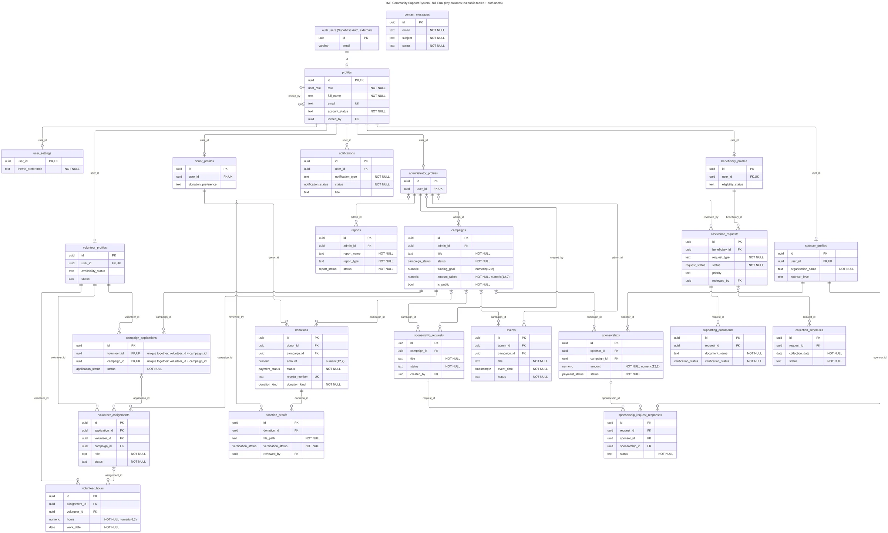

# TMF Database Seed Data

This folder supplies controlled sample data for the Themba Molefe Foundation Community Support System. It supports testing of all five roles: administrator, donor, volunteer, beneficiary and sponsor.

[Back to project overview and team](../../README.md) | [Database migrations](../migrations/) | [API documentation](../../api/README.md)

The ERD is the report's baseline, not a substitute for current migrations. The later deletion migration changes `donations.donor_id` to nullable with `ON DELETE SET NULL`. Open the image separately for larger text. [Image provenance](../../docs/images/SOURCES.md).

## Files and intended data

| File | Purpose |
| --- | --- |
| [01_seed_auth_users.sql](01_seed_auth_users.sql) | Creates 42 confirmed test accounts and email identities. Uses a test-password placeholder; no actual shared password is documented here. |
| [02_seed.sql](02_seed.sql) | Seeds public-schema data with fixed UUIDs in one transaction; designed for repeatable inserts. |
| [03_seed_verify.sql](03_seed_verify.sql) | Read-only checks for counts, relationships, seed isolation and business rules. |
| [04_seed_cleanup.sql](04_seed_cleanup.sql) | Removes seed data/accounts and refuses cleanup where non-seed records depend on seed records. This is destructive and requires approval. |
| [accounts.tsv](accounts.tsv) | Lists test-account emails, roles, login eligibility and status. |

The intended spread is **2 administrators and 10 each of the other four roles**. Fourteen accounts receive the disposable test password: both administrators and the first three accounts per other role. The remaining 28 have an empty password hash and are data-only, not password-login accounts. Domain records include campaigns, donations/proofs, assistance requests/documents, volunteer work and sponsorships.

Seed identifiers use `5eed____-5eed-4eed-8eed-5eed5eed5eed`; emails use `seed.%@example.com`, receipts start with `TMF-SEED-`, and seeded report metadata contains `"seed": true`. These conventions distinguish demonstration records from operational data.

## Controlled execution

These are SQL scripts, not an npm component. There is no tracked `gen/` generator or `harness/` directory in this checkout, despite historical script-header references to a generator.

Use an authorised Supabase SQL Editor session with the required database privileges. **Do not re-seed or clean up a live project without explicit approval.** Prefer a disposable test project.

1. Confirm the schema and Auth tables match the script prerequisites. Script 01 checks Auth columns and conflicting IDs/emails before inserting.
2. In the SQL Editor only, replace the `__SET_TEST_PASSWORD_HERE__` value in the `with pw(v)` line of script 01 with a disposable test-only password, run the script and close the tab without saving that password to source control. The file also contains a safety-check reference to the placeholder; do not treat that check as a real credential.
3. Run script 02. It activates the intended accounts, promotes the two test administrators and inserts related public records.
4. Run script 03 and review every result plus the `SUMMARY | RESULTS | PASS` row. Do not assume an older pass still represents the current database.
5. Only with approval, use script 04 to remove seed records. Uploaded Storage objects require separate controlled cleanup; SQL row removal does not prove uploaded files were removed.

The Task 3 report records seed application on **8 October 2026** and a successful verification. That is historical evidence; this README update did not execute SQL or re-verify the live database.

## Settings, notifications and account deletion

Seed profiles have `user_settings`. [Preference enforcement](../migrations/20261008150000_enforce_notification_preferences.sql) checks those settings before inserting in-app notifications. Request preferences cover application, assistance and contact notifications; campaign and donation notifications use their own switches. Missing settings default to enabled.

[Account self-deletion](../migrations/20261108120000_account_self_deletion.sql) is separate from seed cleanup. It deletes the signed-in user's account, blocks administrator self-deletion and retains donation rows without a donor link. `donations.donor_id` references **donor_profiles(id)**, not `profiles(id)` directly. Deployment and a successful live self-deletion were not verified in this update.

Two migration files share the `20261008150000` prefix. Review/reconcile migration history before automated replay. Do not rename or apply migrations blindly against a live database.

## GitHub and verification boundaries

GitHub keeps the SQL scripts and migration history alongside client/API code. [CI](../../.github/workflows/ci.yml) runs required web lint/build/tests, API type-check/tests/build and mobile type-check/tests/export. It does **not** apply these seed scripts or prove production database state. API tests use test doubles, including [notification preference tests](../../api/tests/notificationPreferences.test.ts).

For client recovery, privacy pages, Android signing and the latest **v1.0.5** release, see [the project README](../../README.md) and [GitHub Releases](https://github.com/OdirileMasemola/TMF-community-support-system/releases). Google Play status is prepared, not published.
