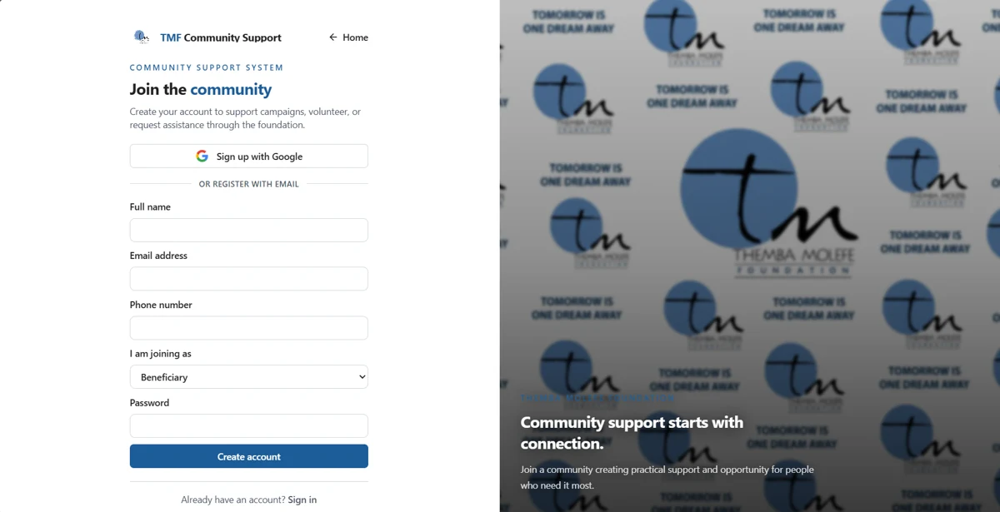
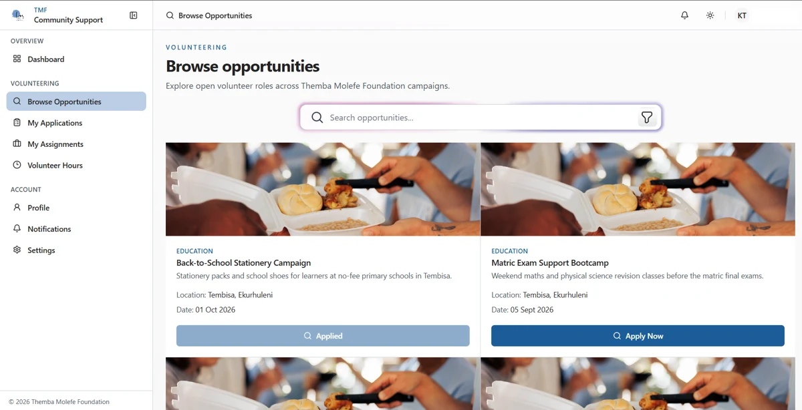
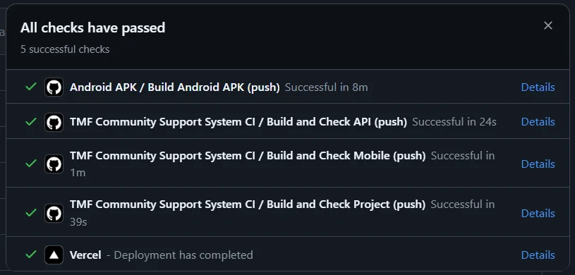

<p align="center"></p>

# TMF Website and Management Portals

The website is the Themba Molefe Foundation's public front door and browser-based operations system. Visitors can learn about the foundation, explore campaigns, get involved, donate and make contact. Signed-in users work in one of five portals.

[Project overview and team](../README.md) | [Mobile app](../mobile/README.md) | [REST API](../api/README.md)



The report screenshot shows **registration**, including Google and email options.

## Role-based features

| Role | Browser workflows |
| --- | --- |
| Administrator | Users, campaigns, donations and proof review, assistance requests, volunteer applications, sponsorships, events, collections and reports. |
| Donor | Campaign giving, donation history, payment proofs, profile and notification settings. |
| Volunteer | Opportunities, applications, assignments, hours and profile details. |
| Beneficiary | Assistance requests, supporting documents, decisions and collection information. |
| Sponsor | Sponsorship commitments, open requests, expressions of interest and history. |



## Design and technology

React, TypeScript and Vite provide the client; React Router handles navigation, Tailwind CSS supports styling and TanStack Query manages server data. Public pages and portal layouts are separated so visitors and operational users have different navigation. Responsive layouts, TMF branding, clear statuses, validation feedback and light/dark theme support keep the interface consistent with mobile.

The website signs in through Supabase Auth, calls the Fastify API with the user's bearer token, and uses Supabase directly for authentication, file uploads and selected data operations. Role checks and database RLS protect data; hiding menu items is not the security boundary. See the [architecture and ERD](../README.md#technology-and-architecture).

## Password recovery, preferences and privacy

- Select **Forgot password** on sign-in, request a recovery email at `/forgot-password`, then follow the link to `/reset-password` and choose a new password. [Auth hooks](src/features/auth/hooks/useAuth.tsx) handle recovery events. Supabase recovery email delivery and allowed redirects must include the deployed/local website origin and reset route.
- Portal Settings save campaign, request and donation notification choices through the [shared preference panel](src/components/shared/NotificationPreferencesPanel.tsx). [The database enforcement migration](../supabase/migrations/20261008150000_enforce_notification_preferences.sql) suppresses disabled categories before inserting **in-app** notifications; it is not push/email delivery.
- Public routes `/privacy-policy` and `/account-deletion` explain data use, retained donation records and deletion options. [The deletion page](src/pages/public/AccountDeletionPage.tsx) describes mobile Settings deletion and the support route; this is not a web self-delete button.
- The mobile deletion RPC requires [its database migration](../supabase/migrations/20261108120000_account_self_deletion.sql). Deployment and live deletion were not verified during this README update.

## Setup and commands

From the repository root:

```bash
cd web
npm ci
npm run dev
```

Configure `VITE_SUPABASE_URL` and `VITE_SUPABASE_PUBLISHABLE_KEY` locally. `VITE_SUPABASE_ANON_KEY` is supported as a fallback. These are client-visible public configuration, never a service-role key. Optionally set `VITE_API_URL`; it defaults to `https://tmf-task2-api.azurewebsites.net`. For a local API, set it to `http://localhost:3000` and allow the web origin through API CORS. Restart Vite after configuration changes.

Use Node 22.13+ on the 22.x line for a shared project development environment; the current web CI job uses Node 20. Supabase schema, OAuth provider settings and recovery redirect allowlists must be configured separately.

| Command | Purpose |
| --- | --- |
| `npm run dev` | Start Vite development server; use the URL printed in the terminal. |
| `npm run lint` | Run ESLint with zero warnings allowed. |
| `npm test` | Run Vitest once, including auth/recovery and settings tests. |
| `npm run build` | Type-check with `tsc -b` and create the Vite bundle in `dist/`. |
| `npm run preview` | Preview the production bundle locally. |

## GitHub and CI

[The shared CI workflow](../.github/workflows/ci.yml) runs on pushes to `main` and pull requests targeting `main`. The web job installs locked dependencies, runs **required lint**, builds with the two `VITE_SUPABASE_*` repository secrets and runs tests. API and mobile checks run in parallel. GitHub holds the source, migrations, history and releases; the website includes [Vercel routing configuration](vercel.json).



This report screenshot is historical evidence, not the status of the current commit. For Android APK/AAB signing and debug fallback, see [mobile build documentation](../mobile/README.md#android-builds-and-signing). Latest project release: **v1.0.5**, available on [GitHub Releases](https://github.com/OdirileMasemola/TMF-community-support-system/releases). Google Play preparation is documented at the root; the app is **not published**.

## Images

Screenshots come from the Task 3 report and have been compressed for documentation. They may show an earlier build. See [image sources](../docs/images/SOURCES.md) and [website asset conventions](src/assets/images/README.md).
