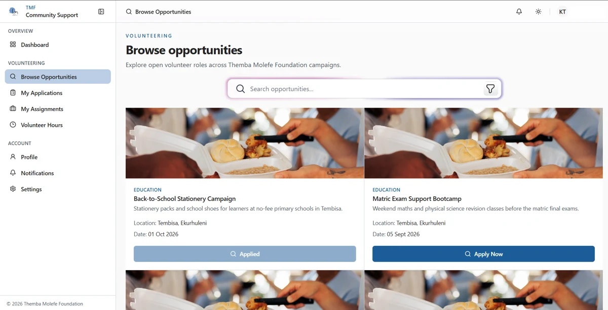

# TMF Website Image Assets

This folder holds images imported by the React website: foundation branding, the homepage hero, campaign imagery, donation/about photographs and authentication artwork. Use the existing TMF identity rather than creating replacement logos.

[Back to the project overview](../../../../README.md) | [Website documentation](../../../README.md)

## Existing logo and image locations

| Asset | Location relative to this folder | Use |
| --- | --- | --- |
| [TMF source logo](logo.jpeg) | `logo.jpeg` | Imported website branding. |
| [Public TMF logo](../../../public/tmf-logo.png) | `../../../public/tmf-logo.png` | Public/static branding and README logo. |
| [Mobile brand logo](../../../../mobile/assets/brand/logo.jpeg) | `../../../../mobile/assets/brand/logo.jpeg` | Mobile branding. |
| [Website hero](hero.webp) | `hero.webp` | Main public-site imagery. |
| [Campaign images](campaigns/) | `campaigns/` | Existing campaign photographs. |
| [About images](about/) | `about/` | Foundation imagery. |
| [Donation images](donation/) | `donation/` | Donation-page imagery. |
| [Authentication background](auth/Auth.webp) | `auth/Auth.webp` | Account screens. |

## Documentation screenshots

Documentation screenshots are stored centrally in [docs/images](../../../../docs/images/), rather than bundled into the application. They were extracted from the Task 3 report and optimised as WebP. [SOURCES.md](../../../../docs/images/SOURCES.md) records each image and its limitations. This screenshot shows a real volunteer screen; it is not a public-page wireframe.

## Design and usage conventions

- Reuse TMF's existing logo and blue/white identity consistently across public pages and the five portals.
- Keep website runtime assets here when components import them. Use `web/public/` for static assets addressed by public URL.
- Use descriptive filenames for new files and preserve the exact case of existing imports. Some existing campaign filenames contain spaces; do not rename them without updating every reference.
- Prefer compressed WebP for photographic content, retain aspect ratio and supply useful alternative text in components.
- Do not add passwords, tokens or private account details to screenshots. Avoid treating historical screenshots as proof of current deployment behaviour.

Image changes belong in the same GitHub history as the components that use them. The [CI workflow](../../../../.github/workflows/ci.yml) enforces web lint and builds/tests the application, but it does not inspect image licences or perform visual review. Review those separately. Project purpose, architecture, team and release details are in the root README; latest release is **v1.0.5** on [GitHub Releases](https://github.com/OdirileMasemola/TMF-community-support-system/releases).
